# Práctica: Simulación de phishing con Gophish

> **Entorno controlado y con fines educativos.** Toda la práctica se ha realizado en un
> laboratorio propio, utilizando únicamente cuentas de correo de prueba creadas para la
> ocasión. El objetivo es comprender el funcionamiento de las campañas de *phishing* para
> poder defenderse de ellas y concienciar sobre ingeniería social. No debe emplearse contra
> personas o sistemas sin autorización expresa.

## Objetivo

Montar una campaña de phishing simulada de principio a fin con **Gophish**: clonar una
plantilla de correo legítima, replicar una página de inicio de sesión, configurar el perfil
de envío, lanzar la campaña contra un destinatario de prueba y analizar los resultados.

## Herramientas

- **Gophish** como framework de campañas de phishing.
- Una cuenta de correo de Google de prueba (con verificación en dos pasos y contraseña de aplicación).
- Página de referencia utilizada para la plantilla: `https://portal.offsec.com/sign-in/`.

## Desarrollo

### 1. Plantilla de correo (*Email Templates*)

Tras crear una nueva plantilla, accedemos a la sección **Email Templates**.

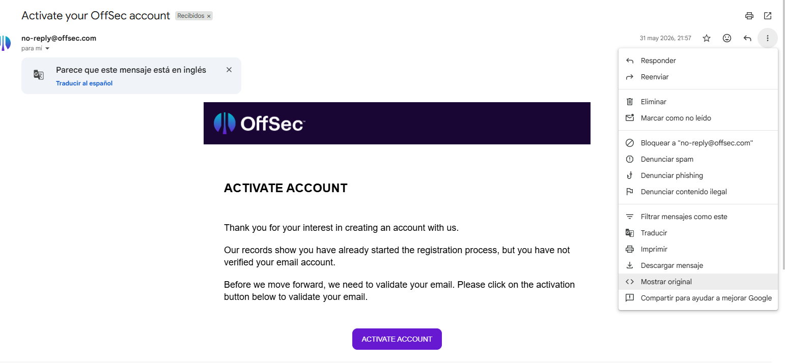

Seleccionamos de nuestro buzón un correo que resulte convincente y copiamos su **código
fuente**. A continuación pulsamos **Import Email** y pegamos ahí el código fuente para
reproducir fielmente el mensaje original.

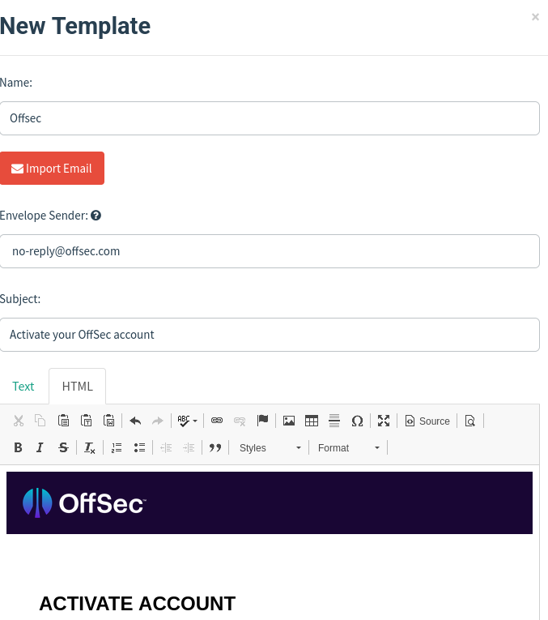

### 2. Página de destino (*Landing Pages*)

Buscamos una página relacionada con la plantilla anterior —por ejemplo, un inicio de sesión
o un cambio de contraseña— y copiamos su enlace. En este caso se utiliza
`https://portal.offsec.com/sign-in/`.

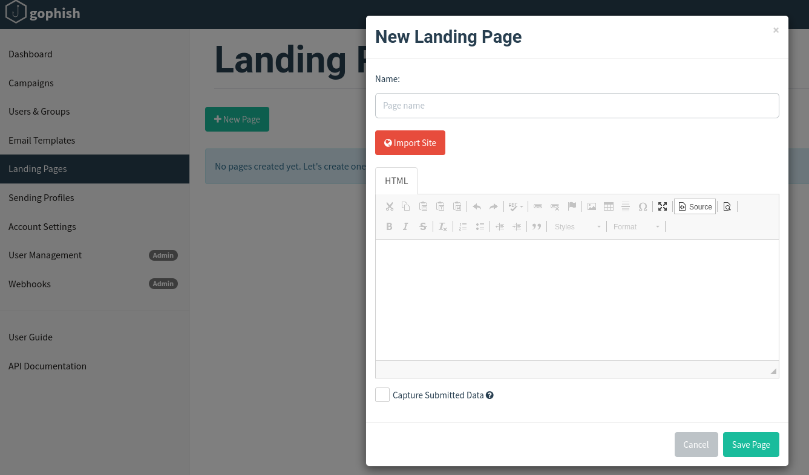

En **Landing Pages → New Page** empleamos el botón de importar para cargar el enlace
anterior. Si la importación automática no reproduce bien la página, recreamos el panel
manualmente pegando el HTML correspondiente en el apartado **Source**.

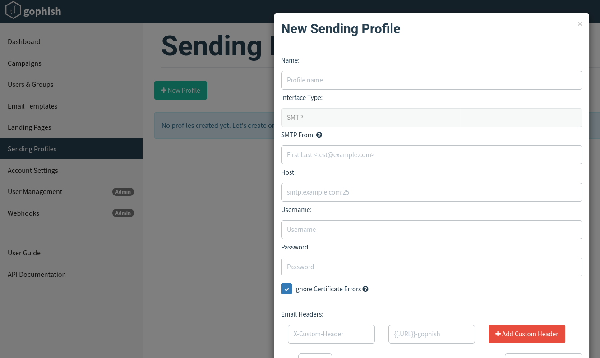

### 3. Perfil de envío (*Sending Profiles*)

Pasamos a **Sending Profiles**, donde se configura el servidor de correo saliente.

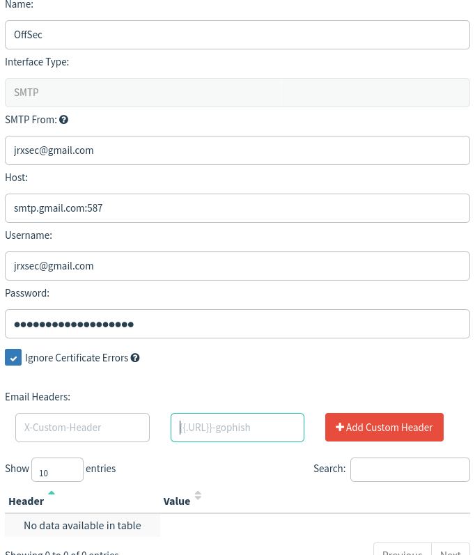

En la cuenta de Google que vamos a utilizar activamos la **verificación en dos pasos** y
generamos una **contraseña de aplicación de 16 caracteres**, que introducimos en el campo
*password* del perfil de envío.

### 4. Usuarios y grupos (*Users & Groups*)

En **Users & Groups** creamos un grupo con un correo de prueba para comprobar cómo llega el
mensaje y verificar que todo funciona. Una vez introducidos los datos, pulsamos **+ Add**.

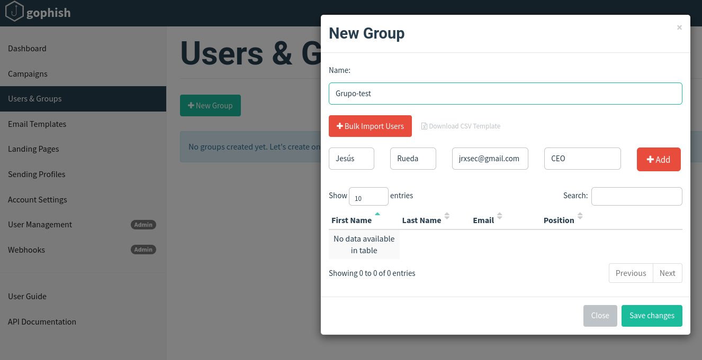

### 5. Comprobación del puerto del servidor

Desde la terminal consultamos el puerto de salida que utiliza el servidor de phishing de
Gophish:

```bash
grep -A3 phish_server /etc/gophish/config.json
```

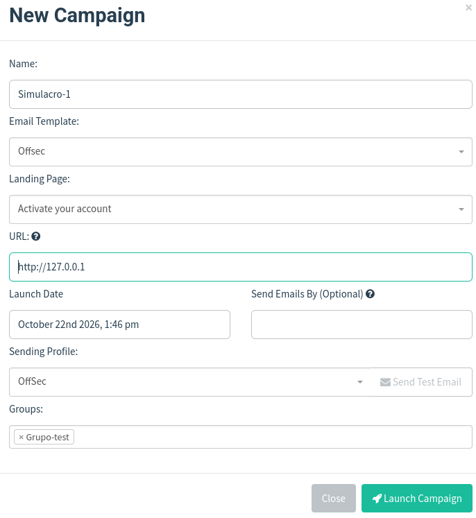

### 6. Lanzamiento de la campaña (*Campaigns*)

Al indicar la configuración el puerto **80**, en **Campaigns** establecemos la URL
`127.0.0.1` y lanzamos la campaña.

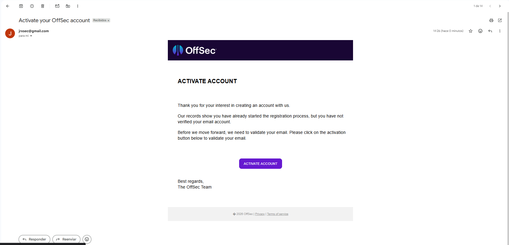

## Resultados

Correo fraudulento recibido por el destinatario de prueba:

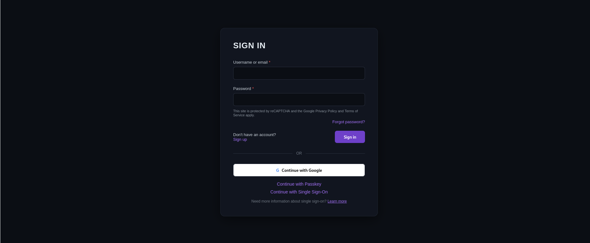

Página de inicio de sesión falsa (clon):

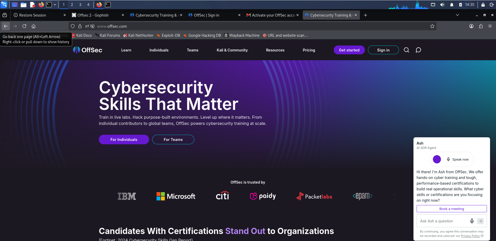

Tras la interacción, redirección a la página oficial de OffSec para no levantar sospechas:

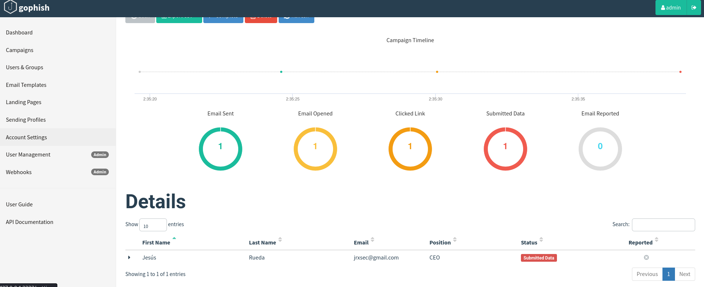

Comparación con el correo real de OffSec y su página de inicio de sesión legítima:

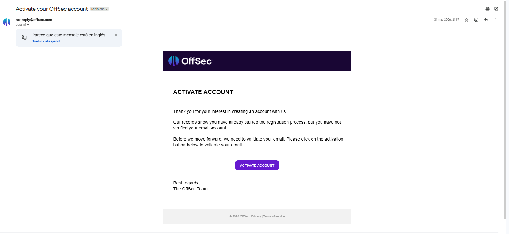

## Conclusiones

La práctica demuestra lo sencillo que resulta clonar un correo y una página de inicio de
sesión legítimos con Gophish, así como lo convincente que puede llegar a ser el resultado.
De ahí la importancia de las medidas de defensa frente a la ingeniería social: verificar
siempre el dominio del remitente y de los enlaces, desconfiar de los correos que solicitan
credenciales, activar la verificación en dos pasos y formar a los usuarios para reconocer
este tipo de ataques.
